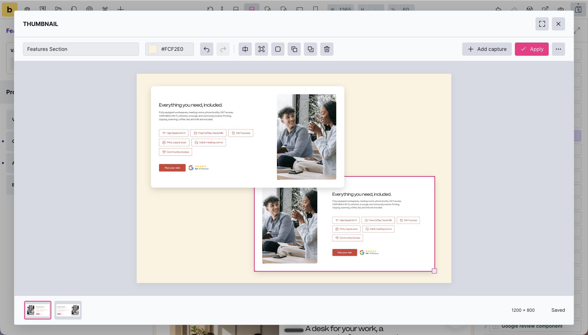
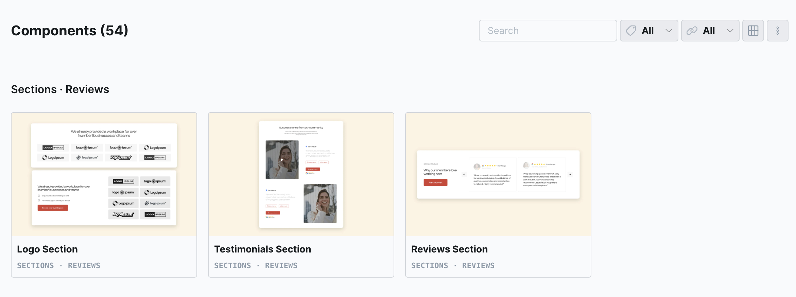

# BricksBuilder Component Thumbnails

**Component Thumbnail Studio** is a WordPress plugin for composing custom Bricks component previews directly inside the Bricks editor.

Capture the component you are editing, arrange one or more views on a canvas, and apply the result to its native thumbnail. Useful for showing visually different variants together in one preview.





## Download and install

1. Download **[component-thumbnail-studio-1.1.0.zip](https://github.com/davehillm/bricksbuilder-component-thumbnails/releases/download/v1.1.0/component-thumbnail-studio-1.1.0.zip)** from [Releases](https://github.com/davehillm/bricksbuilder-component-thumbnails/releases).
2. In WordPress, open **Plugins → Add New Plugin → Upload Plugin**, upload the ZIP, and activate it.
3. Enable component screenshots in **Bricks → Settings → Templates & components**.
4. Reload the Bricks editor, select a component instance, and click the camera in the main toolbar.

Use the attached plugin ZIP for installation. GitHub’s automatic “Source code” archives contain the development repository and optional extras.

## Features

- Capture the currently rendered component, including its variant, properties, slots, and breakpoint.
- Combine up to 12 screenshots in one 1200 × 800 thumbnail.
- Drag and proportionally resize each screenshot, with keyboard controls and undo/redo.
- Edit the background color using a swatch or hex value.
- Apply per-image border, corner-radius, and shadow presets, with individual fine-tuning.
- Save arrangements automatically and reopen them for later editing.
- Assign a composition to another component.
- Keep custom previews protected from native screenshot regeneration while the plugin is active.

To capture another view, choose **Add capture**, select the next component or variant in Bricks, and click the camera again. **Apply** saves the finished image to the Media Library and assigns it to the component.

The camera in the Component Browser opens an existing composition. **Use automatic thumbnail**, in the three-dot menu, releases the custom assignment and requests a normal Bricks screenshot.

## Optional sidebar thumbnails

The separate **[sidebar component previews snippet](extras/README.md)** replaces the icons in Bricks’ normal Components sidebar with saved thumbnails and enlarges the rows. Components without a usable thumbnail keep their native icon.

It lives in this repository’s `extras` folder and is installed separately through a PHP code manager. It does not need Thumbnail Studio, so it can remain active after the plugin is removed. It creates no additional images or editing data.

## Requirements and compatibility

- WordPress 6.5 or later.
- PHP 8.2 or later, OpenSSL, and a working WordPress image editor, such as GD or Imagick.
- Bricks **2.4.x**, with component screenshots enabled.
- Permission to edit the current page and Bricks components, and to upload media.

Live integration was checked with **Bricks 2.4.4, WordPress 7.1.4, and PHP 8.3**. The editor adapter depends on Bricks internals because there is no documented public screenshot-composition API. Other Bricks versions require a compatibility review; the interface does not attach outside the supported version range.

Captures are static. Cross-origin assets must permit browser access. Third-party frames, live video, and WebGL have browser capture limitations; use video poster images. Source captures are limited to 5 MB and 16 megapixels each.

This is an independent community project, unaffiliated with Bricks. A Bricks installation is required; Bricks itself is not included.

## Removal and stored images

Deactivate and delete the plugin through WordPress’s Plugins screen. Uninstall removes its editing recipes, encrypted source captures, scheduled cleanup, and ownership metadata. **Finished Media Library images and current native thumbnail assignments remain.** Normal Bricks regeneration resumes and may later replace those assignments.

Deleting the plugin directory directly bypasses WordPress uninstall cleanup. Keep a site backup before trying editor extensions on a production site.

Repeated unchanged Apply reuses the existing finished image. Replaced generated images are retired only when the reference checks find no remaining use. Current draft sources stay available; unused sources have a one-hour recovery period and scheduled cleanup.

## Development

Use Node.js 24.18 or later and npm 11.16 or later. The lockfile pins dependencies; PHP checks use a bundled WASM runtime.

```sh
npm ci
npm run typecheck
npm test
npm run test:php
npm run format:check
npm run build
npm run package
```

The installable ZIP is written to `build/component-thumbnail-studio-1.1.0.zip`. Only the allow-listed runtime files in `plugin/` are packaged. Optional snippets, source files, tests, and development dependencies are excluded.

The existing suite has 14 TypeScript tests and 82 PHP scenarios, including permissions, stale revisions, thumbnail-only writes, source access, output reuse, reference-aware cleanup, and uninstall retention. PHP scenarios use WordPress test doubles. Live editor testing remains necessary for changes to the Bricks adapter.

## License

[GPL-2.0-or-later](LICENSE). The bundled modern-screenshot dependency is MIT licensed; its notice is included in the plugin.
